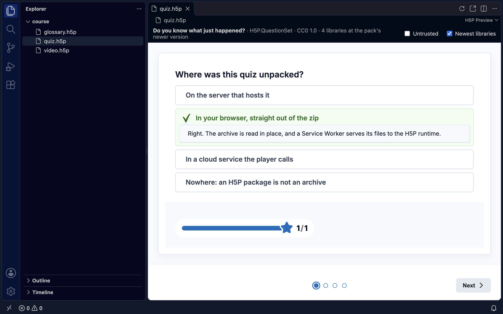

# H5P Preview by Missing Elements

Open a `.h5p` file in VS Code and it plays, in the same player a website runs it with. There is no
H5P server and no account. It works offline, and the package never leaves your computer.

## What it does

- **Click a `.h5p` and it plays** in an editor tab: quizzes, interactive videos, presentations,
  every content type the H5P hub serves. Video streams; a large package starts at once.
- **Exports without their libraries play too.** Packages from h5p.com and h5p.org often carry only
  their content. The extension carries the libraries of every hub content type and supplies what a
  package lacks, with no network.
- **It plays again when the file changes.** Rebuild a package, or let an agent write it again, and
  the tab shows the new version.
- **Open in Browser** plays it in your default browser, served from this computer until you close
  the tab.

## Packages you did not make

A package carries JavaScript. By default the preview runs it, as it plays your own work.

- **Untrusted**, the switch above the content, plays a package as a site plays one it did not
  make. None of its own code runs, its libraries come only from those the extension carries, and
  its content is checked against those libraries' semantics, as the H5P plugins for Moodle,
  WordPress and Drupal check it.
- **In Restricted Mode** every package plays untrusted. Trust the workspace to play packages with
  their own code.
- **Newest libraries**, the other switch, plays the extension's newer version of a library a package
  carries, as a site with up-to-date libraries would. Turn it off to see the package exactly as
  exported.

## Settings

| Setting | Default | |
|---|---|---|
| `h5pPreview.untrusted` | `false` | Play every package untrusted. |
| `h5pPreview.newestLibraries` | `true` | Play the newer versions of the libraries a package carries. |

The switches above each preview override them for that tab.

## Commands

- **H5P Preview: Reload** plays the package again from the start. Also in the editor's title bar.
- **H5P Preview: Open in Browser** plays it in your browser. Also in the title bar, and in the
  Explorer's menu on a `.h5p`.

## How it works

The editor frames a page from a small server the extension runs on `127.0.0.1`, on the first free
port from 4646. It serves the package, the player, the H5P runtime and the libraries, and nothing
else. The player reads the package where it is: the libraries in a few reads, media in the ranges
the content asks for. Nothing is unpacked into your folders.

In a remote or virtual workspace, the extension runs on this computer and copies the file to a
temporary folder here before it plays.

## Requirements

VS Code 1.90 or later, on the desktop. VS Code for the Web cannot run the server.

## Related

- [h5p-offline-player](https://github.com/missing-elements/h5p-offline-player): the player, a web
  component that plays H5P on any website you host, with no H5P server.
- [h5p-verify](https://github.com/missing-elements/h5p-offline-player/tree/main/packages/verify):
  checks from the command line that a package plays; `--preview` opens it in your browser.
- [h5p-normalize](https://github.com/missing-elements/h5p-offline-player/tree/main/packages/normalize):
  rewrites a package so that its video streams.

## Licence

MIT. The extension carries the H5P core runtime (GPL-3.0) and the hub's libraries, each under its
own licence; `NOTICE.txt` lists them.

H5P is a trademark of H5P Group. This extension is made by Missing Elements and is not affiliated
with or endorsed by H5P Group.
